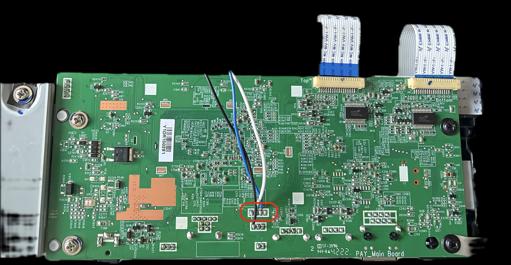
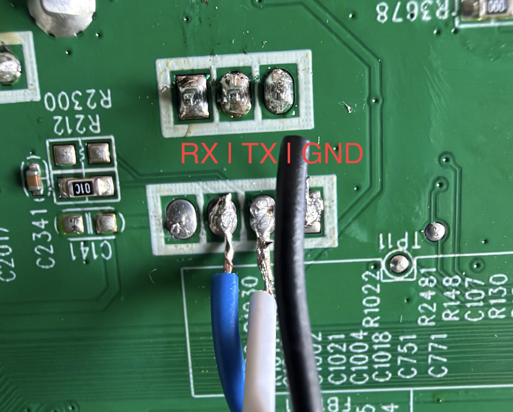

# HP ScanJet Pro N4000 snw1: Admin-Passwort über UART wiederherstellen

Diese Anleitung beschreibt, wie ich nach einer fehlerhaften Passwortänderung wieder Zugriff auf den **HP Embedded Web Server (EWS)** meines ScanJet Pro N4000 snw1 bekommen habe. Sie hilft auch bei einem vergessenen EWS-Admin-Passwort, sofern sich das Gerät wie das hier getestete Exemplar verhält.

Der Weg: Gehäuse öffnen, die **3,3-V-UART-Konsole mit 115200 Baud** anschließen, das tatsächlich gespeicherte Passwort lokal auslesen und damit im Webinterface ein neues Passwort setzen. Beim getesteten Gerät war dafür weder ein Werksreset noch ein Firmware-Flash nötig; die vorhandenen Einstellungen konnten erhalten bleiben.

> **Geltungsbereich:** Eigener Erfahrungsbericht an einem einzelnen Gerät mit **Main-Board-Firmware v0.95**. Andere Firmwarestände und Platinenrevisionen können sich anders verhalten. Diese Anleitung ist kein offizielles HP-Serviceverfahren. Verwende sie nur an einem eigenen Gerät oder mit Erlaubnis des Eigentümers.

## Mein Fall: Das richtige Passwort war plötzlich „falsch“

Ich hatte auf dem Scanner mit Firmware v0.95 folgendes Admin-Passwort gesetzt:

| Wert | Passwort | Länge |
|---|---|---:|
| Von mir eingegeben | `Lw-7QgpNAx47rovftTttGffEhIOhs3d` | 31 Zeichen |
| Im Gerät gespeichert | `7QgpNAx47rovftTt` | 16 Zeichen |

Das gespeicherte Passwort war also nicht einfach das Original und auch nicht dessen erste 16 Zeichen: Es entsprach **Zeichen 4 bis 19** des eingegebenen Werts. Das Präfix `Lw-` und der hintere Teil fehlten. Mit dem ursprünglichen Passwort wurde der Login abgelehnt.

Ich kontaktierte HP. Der Support eröffnete ein Ticket und ging mit mir verschiedene Abläufe durch. Am Ende wurde vermutet, dass ich das Gerät „gebrickt“ hätte. Ein funktionierender Weg zur Wiederherstellung des Zugangs ergab sich dabei nicht.

Nach dem Öffnen des Scanners fand ich den UART-Anschluss. Die Verbindung führte direkt zu einer Linux-Root-Shell, ohne vorherige Anmeldung. Dort konnte ich das gespeicherte EWS-Passwort auslesen und den Unterschied zum eingegebenen Wert erkennen. Der Scanner bootete weiterhin; in meinem Fall war der verlorene Admin-Zugang das Problem.

**Aus dieser einzelnen Beobachtung folgt kein allgemeiner Kürzungsalgorithmus.** Insbesondere ist nicht nachgewiesen, dass jedes lange Passwort unter v0.95 an derselben Stelle abgeschnitten wird oder dass das führende Sonderzeichen die Ursache war.

Die beiden oben gezeigten Passwortwerte sind absichtlich Teil dieses öffentlichen Fallberichts. Verwende sie nicht als neues Passwort.

## Vor dem Öffnen: Ein einfacher Versuch

Wenn du das ursprünglich gesetzte lange Passwort noch kennst, kannst du zunächst dessen **erste 16 Zeichen** im EWS ausprobieren. Ein Nutzer konnte den Zugang unter Firmware **0.51** auf diese Weise wiederherstellen. Das beschreibt dieser [Erfahrungsbericht in der HP Support Community](https://h30434.www3.hp.com/t5/Scanning-Faxing-Copying/ScanJet-Pro-N4000-snw1-password-reset/td-p/8030034).

Das ist keine garantierte Lösung: In meinem Fall unter v0.95 waren gerade **nicht** die ersten 16 Zeichen gespeichert. Bleibt die Anmeldung erfolglos oder ist das ursprüngliche Passwort unbekannt, folgt der UART-Weg.

## Was du brauchst

- HP ScanJet Pro **N4000 snw1**; mein Gerät hat die Produktnummer **6FW08A**.
- Einen USB-UART-Adapter mit **3,3-V-Signalpegeln**. Ich verwendete einen **DSD TECH SH-U09B mit CP2102**.
- Einen Computer mit einem seriellen Terminal; die folgenden Beispiele verwenden macOS und `screen`.
- Multimeter, geeignete Leitungen und Werkzeug zum Öffnen des Geräts. Die fotografierten Leitungen sind angelötet; sauberes Löten oder eine sichere Kontaktierung ist erforderlich.
- Empfohlen: ein **1-kΩ-Widerstand in der Leitung vom Adapter-TXD zum Scanner-RX**, um den Strom bei einer Fehlzuordnung zu begrenzen. Dieser zusätzliche Widerstand ist auf den Fotos nicht dargestellt.

**Elektrisch wichtig:** Verwende TTL-UART mit 3,3 V, keinen klassischen RS-232-Pegel und kein 5-V-TX-Signal. **3V3, 5V0 und sonstige Versorgungspins des Adapters bleiben unverbunden.** Der Scanner wird über sein eigenes Netzteil versorgt. Ein 3V3-Anschluss am Adapter ist für sich allein kein Nachweis des TXD-Signalpegels; miss TXD gegen Adapter-GND im Ruhezustand, bevor du ihn mit dem Scanner verbindest.

Öffne und löte nur bei getrenntem Netzteil und getrenntem USB-Adapter. Arbeite mit ESD-Schutz und vermeide lose Drähte, Lötbrücken oder Kontakt zum Metallgehäuse. Bei der späteren Messung liegt die Platine offen und ist versorgt; berühre nur die vorgesehenen Niederspannungsanschlüsse. Falsche Verdrahtung kann das Gerät oder den Adapter beschädigen.

## 1. UART-Anschluss auf der Hauptplatine finden

Das Übersichtsbild zeigt die **Lötseite der Hauptplatine**. Der verwendete Anschluss ist rot umkreist. Die Bezeichnung **J8** wurde anhand der Fotos der gegenüberliegenden Bestückungsseite zugeordnet; auf den beiden hier eingebundenen Bildern ist der Aufdruck nicht lesbar.



Im **Detailfoto unten ist die untere Viererreihe gemeint**, an der die drei Drähte angeschlossen sind. Die darüber liegende Dreierreihe gehört nicht zu dieser Verbindung. Das Detailfoto ist gegenüber dem Übersichtsbild um etwa 180° gedreht.



**RX und TX sind aus Sicht des Scanners beschriftet.** Die Farben beziehen sich nur auf meine angelöteten Drähte, nicht auf eine genormte Kabelfarbe des USB-Adapters.

| Anschluss | Funktion am Scanner | Draht im Foto | Verbindung am USB-UART-Adapter |
|---|---|---|---|
| A | GND | Schwarz | GND |
| B | TX: Scanner sendet | Weiß | RXD: Adapter empfängt |
| C | RX: Scanner empfängt | Blau | TXD: Adapter sendet, vorzugsweise über 1 kΩ |
| D | Unbekannt | Nicht verdrahtet | Nicht anschließen |

Die Blickrichtung macht einen Unterschied:

- **Übersicht `frontpcb.jpg`, links nach rechts:** A/GND, B/TX, C/RX, D/unbekannt.
- **Detail `pins.jpg`, untere Reihe links nach rechts:** D/unbekannt, C/RX, B/TX, A/GND.

GND wurde elektrisch bestimmt; TX und RX wurden durch lesbare Bootmeldungen und eine funktionierende Shell-Verbindung bestätigt. Eine gemessene Spannung von ungefähr 3,3 V allein unterscheidet keinen RX-Eingang von einem Versorgungspin oder einem anderen Ausgang. D bleibt deshalb unverbunden.

## 2. Adapter verbinden und Terminal öffnen

Bereite die Verdrahtung bei stromlosem Scanner und vom USB getrenntem Adapter vor. Nimm anschließend zuerst den Scanner in Betrieb und verbinde danach den Adapter mit dem Computer. So treibt der Adapter-TXD kein Signal in den noch unversorgten Scanner.

| Einstellung | Wert |
|---|---|
| Signalpegel | 3,3 V |
| Baudrate | 115200 |
| Datenbits | 8 |
| Parität | Keine |
| Stoppbits | 1 |
| Flusskontrolle | Keine, weder RTS/CTS noch XON/XOFF |

Unter macOS kannst du die verfügbaren Anschlüsse anzeigen:

```sh
ls /dev/cu.*
```

Mein Adapter erschien als `/dev/cu.usbserial-0001`. Ersetze diesen Namen durch den Anschluss deines Adapters:

```sh
screen -fn /dev/cu.usbserial-0001 115200
```

`-fn` schaltet bei `screen` die Flusskontrolle aus. Für diese Anleitung wird die Terminalausgabe nicht automatisch mitgeschrieben, da beim späteren Auslesen Passwörter sichtbar werden.

Unter Linux kann der Anschluss beispielsweise `/dev/ttyUSB0` heißen. In einem anderen Terminalprogramm stellst du dieselben Parameter aus der Tabelle ein. Öffne den Anschluss immer nur in einem Programm gleichzeitig.

Drücke nach dem Hochfahren **Enter**. Im getesteten Firmwarestand erschien direkt:

```text
/ #
```

Prüfe die Rechte:

```sh
id
```

Die Ausgabe meines Geräts war:

```text
uid=0(root) gid=0(root)
```

Falls du nur Ausgaben lesen kannst, kontrolliere insbesondere die Leitung Adapter-TXD → Scanner-RX. Falls Zeichen unlesbar sind, prüfe Signalpegel, Masse und Terminalparameter. Ein echter Login-Prompt statt einer Root-Shell wäre ein Unterschied zum getesteten Gerät; dafür ist hier kein Standardpasswort belegt.

Zum Beenden von `screen`: **Strg+A**, Tasten loslassen, dann **K**, anschließend mit **Y** bestätigen.

Für einen Bootmitschnitt kannst du den Adapter zunächst nur mit GND und seinem RXD anschließen und den Empfang vor dem Einschalten starten. Die TXD-Leitung verbindest du erst, wenn der Scanner versorgt ist. **Vor dem Ausschalten des Scanners TXD wieder trennen**, wenn der Adapter weiter per USB versorgt bleibt; sonst ist Rückspeisung über das Signal möglich.

## 3. Tatsächlich gespeichertes EWS-Passwort lokal auslesen

Das Passwort lag bei meinem Gerät **im Klartext** in:

```text
/datafs/H1_nvram.bin
```

In meinen Untersuchungsnotizen ist es dem NVRAM-Feld **`sNetSetting.szEWSPass`** zugeordnet. Dieser Feldname ist eine technische Zuordnung aus der Untersuchung, kein Dateipfad und kein hier dokumentierter Schreibbefehl.

Prüfe zuerst, ob die Datei vorhanden und das Datenverzeichnis eingehängt ist:

```sh
ls -l /datafs/H1_nvram.bin
mount | grep /datafs
```

Lies die druckbaren Zeichenfolgen der Datei:

```sh
strings -a -t x /datafs/H1_nvram.bin
```

`-t x` zeigt zusätzlich die Position der Zeichenfolge als hexadezimalen Dateioffset. Falls die auf deinem Gerät vorhandene `strings`-Version diese Option nicht unterstützt, genügt zur Ansicht:

```sh
strings /datafs/H1_nvram.bin
```

**Prüfe die Ausgabe lokal.** Sie kann neben dem EWS-Passwort weitere vertrauliche Konfigurationswerte enthalten. Lade weder die vollständige Ausgabe noch die NVRAM-Datei, Terminalmitschnitte oder ungeschwärzte Screenshots in ein öffentliches Issue hoch.

Im untersuchten Fall war der Passwortstring im Umfeld von Modell- und Hostnamen zu finden. Wenn du dein ursprünglich gesetztes Passwort noch kennst, lässt sich ein gespeichertes Fragment damit vergleichen. Bei einem völlig unbekannten Passwort sind andere druckbare Werte kein sicherer Nachweis: Ordne den Kandidaten anhand des Dateikontexts zu und prüfe ihn im EWS.

In meinen Notizen liegt der betreffende Wert bei Offset **`0x158`**. Das ist eine Beobachtung an diesem Gerät, **kein universeller Offset**. Die oben gezeigten Befehle lesen die Datei nur; sie verändern keine NVRAM-Daten.

## 4. Im Webinterface anmelden und Passwort neu setzen

1. Ermittle die aktuelle IP-Adresse über das Bedienpanel oder die Geräteliste deines Routers und öffne das EWS im Browser, beispielsweise `https://<IP-des-Scanners>`.
2. Wähle die Administrator-Anmeldung und verwende als Passwort **genau den im Gerät gefundenen Wert**. In meinem Fall war das `7QgpNAx47rovftTt`.
3. Öffne die Einstellung für das Administratorpasswort im Sicherheitsbereich des EWS. Der genaue Menütext kann je nach Sprache und Firmware variieren; verwechsle das Admin-Passwort nicht mit Scan-PINs, SMTP-, WLAN- oder Linux-Root-Passwörtern.
4. Setze vorläufig ein anderes, zufälliges Passwort mit **höchstens 16 ASCII-Zeichen**. Ein zufälliger Wert aus Buchstaben und Ziffern vermeidet bei diesem Firmwarestand zusätzliche Unsicherheit durch Sonderzeichen oder Mehrbyte-Zeichen. Das ist ein vorsichtiger Workaround, kein Nachweis, dass alle anderen Zeichen fehlerhaft verarbeitet werden.
5. Melde dich ab und in einer neuen Browser-Sitzung mit dem neuen Passwort wieder an. Eine noch offene, bereits angemeldete Sitzung ist kein Test des neuen Passworts.
6. Prüfe bei Gelegenheit auch die Anmeldung nach einem regulären Neustart. Erst damit ist bestätigt, dass die Änderung auf deinem Gerät dauerhaft gespeichert wurde.

In meiner Untersuchung funktionierte ein anschließend gesetztes Passwort mit acht Zeichen. Daraus folgt keine Empfehlung für kurze Passwörter: Wähle innerhalb der hier verwendeten Begrenzung einen möglichst langen, zufälligen Wert und halte den EWS-Zugang auf dein vertrauenswürdiges Netzwerk beschränkt.

Ein Werksreset ist für diesen Weg nicht erforderlich. Er wäre eine zusätzliche Maßnahme und kann Netzwerk- und Scan-Einstellungen entfernen. **Das Linux-Kommando `passwd root` ist nicht der in diesem Fall verwendete Weg zur Änderung des EWS-Admin-Passworts.**

## Technische Beobachtungen und Grenzen

| Beobachtung | Umfang des Nachweises |
|---|---|
| Direkte UART-Root-Shell ohne Login | Am beschriebenen Gerät mit Main Board v0.95 / Panel v0.71 bestätigt |
| UART-Konsole | `console=ttyS0,115200n8` in der Kernel-Kommandozeile |
| Betriebssystem | Linux 4.4.76, Kernel-Build vom 16. April 2025, `armv5tel` |
| Root-Dateisystem | `/dev/mmcblk0p2`, SquashFS; im Bootlog schreibgeschützt eingehängt |
| EWS-Passwort | Im untersuchten `/datafs/H1_nvram.bin` als lesbarer Klartextwert gefunden |
| Passwortänderung | Über das EWS nach Anmeldung mit dem gespeicherten Wert durchgeführt |

Der Zugriff über UART und die Klartextspeicherung bedeuten, dass das EWS-Passwort im getesteten Stand keine Schutzgrenze gegen jemanden mit physischem Zugriff auf die offene Platine bildet. Eine Änderung des Webpassworts schützt nicht automatisch diese UART-Shell.

Ich habe für die Wiederherstellung **keine Passwortfelder mit `dd` überschrieben, keine unbekannten NVRAM-Werkzeuge mit Schreiboptionen ausgeführt und keine modifizierte Firmware geflasht**. Solche Eingriffe sind hier nicht beschrieben: Ein falscher Offset oder eine beschädigte Konfigurationsstruktur könnte einen funktionierenden Scanner zusätzlich beschädigen.

Nicht belegt sind das Verhalten aller anderen Firmwarestände, die Ursache des verlorenen Präfixes, die Funktion von Pin D sowie ein allgemeiner Reparaturweg für Scanner, die tatsächlich nicht mehr booten.

## Weitere Nutzerberichte und Quellen

Die eigenen Beobachtungen an v0.95 stehen neben früheren Nutzerberichten über Passwortprobleme. Die folgenden Berichte betreffen unterschiedliche Firmwarestände und teilweise unterschiedliche Passwortfelder:

- **EWS-Passwort, Firmware 0.51, 7. April 2021:** [FFWFAF: ScanJet Pro N4000 snw1 password reset](https://h30434.www3.hp.com/t5/Scanning-Faxing-Copying/ScanJet-Pro-N4000-snw1-password-reset/td-p/8030034). Der Betroffene berichtet, dass ein langes Passwort auf die ersten 16 Zeichen gekürzt wurde und die Anmeldung mit dieser Variante gelang. Nach seiner Erinnerung gab es keine Warnung. Das belegt nicht dasselbe Kürzungsmuster wie mein Fall unter v0.95.
- **EWS-Aussperrung, Firmware nicht genannt, 16. Oktober 2023:** [Cannot login to EWS scanner, only user guest](https://h30434.www3.hp.com/t5/Scanning-Faxing-Copying/Reset-password-Cannot-login-to-ews-scanner-only-user-guest/td-p/8890757). Ein weiterer N4000-Nutzer berichtet von verlorenem Admin-Zugang nach einer Passwortänderung. Der Beitrag belegt keine konkrete Kürzung und keine geklärte Ursache.
- **SMTP-Passwort, Rezensionstitel nennt Firmware 0.6, 24. Februar 2021:** [HP-Produktrezension von „Sad Scanner Owner“](https://www.hp.com/us-en/shop/reviews/hp-scanjet-pro-n4000-snw1-sheet-feed-scanner-6fw08a-bgj). Der Käufer berichtet von stiller Kürzung des E-Mail-Passworts. Das ist ein separates Passwortfeld; Länge und Algorithmus werden nicht genannt.

Diese Beiträge sind Erfahrungsberichte der jeweiligen Nutzer, keine Bestätigung des Fehlers durch HP. Die UART- und NVRAM-Befunde in dieser Anleitung stammen aus meiner eigenen Untersuchung und den dazugehörigen Notizen.

Weitere technische Quellen:

- [HP-Benutzerhandbuch für N4000 snw1 und verwandte Modelle](https://h10032.www1.hp.com/ctg/Manual/c06556933.pdf): EWS-Zugang und Scanner-Einstellungen; es dokumentiert nicht den hier beschriebenen UART-Weg.
- [DSD TECH SH-U09B](https://www.deshide.com/product-details_SH-U09B.html): Verwendeter CP2102-Adapter und Anschlussbezeichnungen.
- [Silicon Labs CP2102/9-Datenblatt](https://www.silabs.com/documents/public/data-sheets/CP2102-9.pdf): UART-Signalpins und elektrische Eigenschaften.

## English quick guide

This repository documents recovery of the **EWS/web-admin password** on one HP ScanJet Pro N4000 snw1 running **main-board firmware v0.95**. A 31-character password was stored as a 16-character substring, losing both its prefix and suffix. This is an observed case, not a proven general truncation rule.

With physical access and permission to service the device, connect a **3.3 V USB-UART adapter at 115200, 8N1, no flow control**. Prepare the wiring with both the scanner power supply and USB adapter disconnected. Power the scanner before connecting the adapter to USB. Scanner GND → adapter GND; scanner TX → adapter RXD; scanner RX → adapter TXD, preferably through a 1 kΩ series resistor. Leave adapter power pins and the unidentified fourth pad disconnected. The two photos have opposite orientations; follow their captions.

The tested scanner provided a root shell without login. Inspect `strings -a -t x /datafs/H1_nvram.bin` locally to find the stored plaintext EWS password, then log into EWS with that exact value and set a different random password of at most 16 ASCII characters as a workaround. Verify login in a fresh browser session and after a restart. Do not publish the configuration dump or overwrite NVRAM offsets. Disconnect adapter TXD before powering off the scanner.
